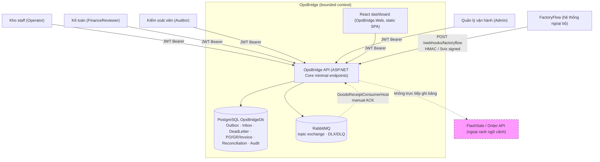
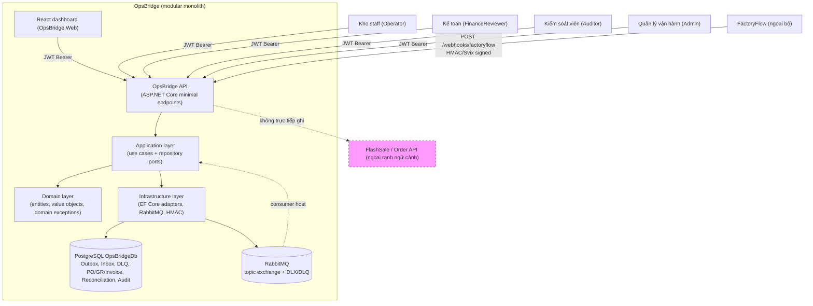
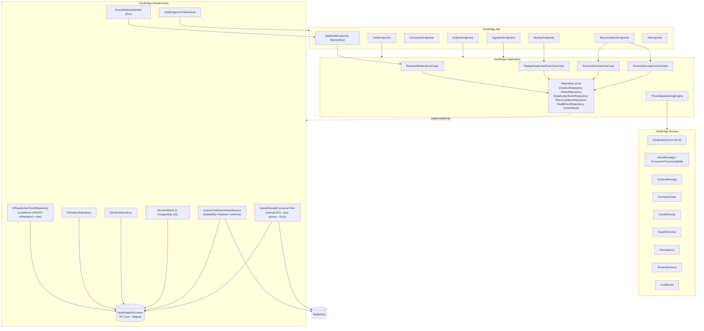

# OpsBridge — C4 Architecture (Context / Container / Component) + Giao thức

> Mục tiêu: tài liệu kiến trúc duy nhất (single source of truth) cho bounded context OpsBridge, đi kèm bảng ranh ngữ cảnh FlashSale ↔ OpsBridge.
> Tham khảo chi tiết: `docs/architecture/system-context.md`, `docs/architecture/container-diagram.md`, `docs/architecture/component-diagram.md`; ADR-017 (ranh ngữ cảnh), ADR-007 (runtime), ADR-015/018/025.
> Triển khai thực tế: `src/OpsBridge.{Api,Application,Domain,Infrastructure}`.

---

## 1. C4 Level 1 — System Context

**Ranh giới tin cậy (trust boundary):**
- `CUSTOMER` là role của FlashSale customer API — **không phải** role của OpsBridge. OpsBridge chấp nhận `Operator`, `Admin`, `Auditor`, `FinanceReviewer` từ JWT tin cậy.
- FactoryFlow là hệ thống ngoại bộ duy nhất được gọi trực tiếp vào OpsBridge API; bảo vệ bằng HMAC/Svix signature (không bearer token).
- OpsBridge API **không trực tiếp ghi** bảng của FlashSale (guard test `ApiEndpoints_MustNotDependOnInfrastructureDbContext`); giao tiếp cross-context qua versioned contract / owner-controlled command (ADR-017).

---

## 2. C4 Level 2 — Container Diagram

**Thứ tự phụ thuộc (không bao giờ đảo ngược):** `Domain ← Application ← Infrastructure ← API`. Domain/Application không tham chiếu EF Core, RabbitMQ, ASP.NET Core.

---

## 3. C4 Level 3 — Component Diagram

**Ranh giới thành phần:**
- `Dom` không tham chiếu bất kỳ gói infrastructure nào (guard `OpsBridge_Domain_MustNotReference_AnyInfrastructurePackage`).
- `App` chỉ phụ thuộc `Dom` (guard `OpsBridge_Application_MustDependOn_Domain`).
- `Infra` không tham chiếu `FlashSale` assembly (guard `OpsBridge_Infrastructure_MustNotReference_FlashSale`).

---

## 4. Giao thức (protocols)

### 4.1 HMAC webhook — FactoryFlow → OpsBridge API

| Thành phần | Chi tiết |
|---|---|
| Endpoint | `POST /webhooks/factoryflow` (mapped in `WebhookEndpoints`) |
| Chứng thực | `HmacWebhookVerifier` (Svix standard): headers `svix-id`, `svix-timestamp`, `svix-signature`; biến thể header tùy chỉnh của OpsBridge |
| Ký | `whsec_` key base64-decode; canonical message `${id}.${timestamp}.${body}`; so sánh các chữ ký cách bởi khoảng trắng, constant-time compare |
| Anti-replay | Cửa sổ 300s; `svix-id` đã xử lý → inbox dedupe |
| Mất phương tin cậy | Nếu verify thất bại → chối trước khi ghi inbox (fail-closed) |

### 4.2 RabbitMQ topology

| Thành phần | Giá trị |
|---|---|
| Exchange | `opsbridge.events.topic` (topic exchange) |
| Queue | `opsbridge.goods-receipts.v1`, binding key `goods.receipt.confirmed.v1` |
| DLX | `opsbridge.events.dlq.exchange` |
| DLQ | `opsbridge.events.dlq` |
| Outbox publisher | `OutboxPublisherHostedService`: RabbitMQ Publisher Confirms (`publisherConfirmationsEnabled: true`); outbox message + business effect cùng 1 PostgreSQL transaction (`IUnitOfWork` / `EfUnitOfWork`) |
| Consumer | `GoodsReceiptConsumerHost`: manual acknowledgements (`autoAck: false`), retry với exponential backoff + jitter, sau 3 retry → DLQ |
| Replay | `POST /api/v1/events/replay/{id}` (RBAC `Operator`/`Admin`), lịch sử audit trong `DeadLetterEvents` |

### 4.3 Outbox / Inbox (tính đáng tin cậy)

- **Outbox:** `OutboxMessage` được ghi cùng hiệu ứng nghiệp vụ trong 1 transaction PostgreSQL (`EfUnitOfWork`). Publisher dịch các message chưa gửi ra RabbitMQ; đã publish đánh dấu gửi thành công (idempotent re-publish).
- **Inbox:** `InboxMessage` + `ConsumerProcessingState` lưu sự kiện đã xử lý; cùng `EventId` + cùng payload → 200 Duplicate; cùng `EventId` + payload khác → `EventPayloadConflictException` → HTTP 409 Conflict.
- Consumer commit business effects + trạng thái xử lý trong 1 transaction **trước khi** `BasicAckAsync` (at-least-once + idempotent consumer; không giả định exactly-once).

---

## 5. Bounded context

| Tiêu chí | FlashSale (Order / Payment) | OpsBridge |
|---|---|---|
| Mục đích | Bán hàng flash sale: chống oversell, xử lý đồng thời cao, idempotency | Nhập kho và đối soát 3 chiều (PO – GoodsReceipt – SupplierInvoice) |
| Actor chính | Khách hàng (buyer), Staff/Admin | Operator, FinanceReviewer, Auditor, Admin |
| CSDL nắm quyền | FlashSaleDb (PostgreSQL) | OpsBridgeDb (PostgreSQL) |
| Broker | RabbitMQ / Azure Service Bus (đơn hàng buffer) | RabbitMQ (`opsbridge.events.topic`, DLX/DLQ) |
| Giao thức chính | HTTP API, Redis Lua gatekeeper | HMAC/Svix webhook, RabbitMQ AMQP, JWT Bearer |
| Hệ thống ngoại bộ | Payment provider, Azure (ACR/AKS/GitOps) | FactoryFlow (webhook `GoodsReceiptConfirmed v1`) |
| UI | — | React dashboard `OpsBridge.Web` |
| Ranh ngữ cảnh | Giao thông qua versioned contract / owner-controlled command; **KHÔNG** trực tiếp ghi bảng của kia (ADR-017) | — |

**DoD P1.6:** ✅ 1 diagram (3 cấp C4 trong 1 file) + 1 bảng bounded context (FlashSale + OpsBridge).
